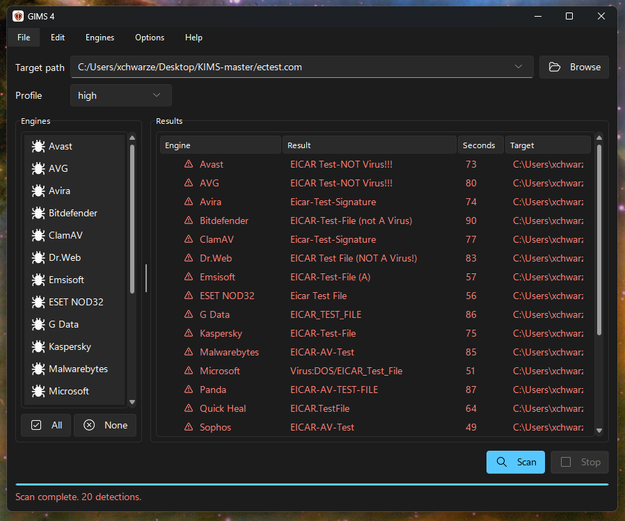

<!-- Shipped as README.md in the lite edition (tools/build_exe.py --lite). Its links are relative to the root of
     that distribution, not to this docs/ folder. -->

<p align="center">
  
</p>

# GIMS Lite

**Scan one file with many antivirus engines and read every verdict side by side.**

GIMS 4, "Güemes Indetectables Multi Scanner", runs antivirus command-line scanners and helper
tools over a file and shows what each one says. This is the **lite edition**: the graphical
interface only, with every engine defined in a plain text file. It needs no installer and stores
nothing in the registry.



## What you get with Lite

- **Drop a file, press Scan.** Each engine runs in turn and its verdict appears in a table, with the
  threat name, the time it took and the file it refers to.
- **Engines are INI files.** Add any command-line scanner by writing a small text file. No code, no
  rebuild. Two examples are included (VBA32 and RHash).
- **Scan profiles, timeouts and a Stop button** that ends the whole process tree.
- **Download and update scripts** per engine, so installing or refreshing one is a menu click.
- **Light and dark themes.** One portable folder.

## Lite or the full version

Lite is enough to look at one file. The full version is what you use to build on top of GIMS.

| | Lite | Full |
|---|---|---|
| Graphical interface, engines as INI files, profiles | Yes | Yes |
| Command line (`gims.exe`) with JSON output and exit codes | No | Yes |
| Scan whole folders and write one report | No | Yes |
| Delete the infected files it finds | No | Yes |
| Save the results as text or JSON, copy them as BBCode | No | Yes |
| Debug window and the raw output of every engine | No | Yes |
| Several instances at the same time | No | Yes |
| Source code | No | Yes |

## Built for infrastructure

GIMS was designed as a framework for building scanning services and distributed scanners, the kind of
thing VirusTotal does: many engines behind one core, driven from a window or from a script, with every
engine described in text so the same setup can be deployed again and again. The command line and its JSON
output are what let other programs feed files in and read verdicts out. The folder reports and the raw
engine output are what make those results easy to process.

Lite deliberately leaves those pieces out.

## Get the full version

The full GIMS is **private** and licensed directly by its developer. If you want to run it on your own
infrastructure, build your own VirusTotal-style service, automate scans from your own tools or work with
the source, write to **DSR!** at <xchwarze@gmail.com> and tell us a little about what you want to build.

## Quick start

1. Unzip anywhere writable and run `gims-gui.exe`.
2. **Engines > Download** (or **Update**) fetches the engines that define a download command. The
   shipped examples are VBA32 and RHash; they are downloaded from their vendors' sites and are
   not bundled.
3. **Engines > Profiles** manages the scan profiles, **Options** sets the theme and the default
   timeout, and **Engines > Edit Engines** creates or edits engine definitions.
4. Drop a file on the window (or use Browse) and press **Scan**.

## What is in the folder

```text
gims-gui.exe                    the application
README.md  LICENSE  VERSION
docs/                           CONFIGURATION.md  VARIABLES.md  THIRD-PARTY-NOTICES.md
config/engines/*.ini            engine definitions (two examples: vba32.ini, rhash.ini)
engines/<name>/                 installed engines, one folder each (created by Download)
bin/<tool>/                     helper tools used by the install scripts: wget, 7z, lessmsi
scripts/                        install and update scripts run by the engines
downloads/  logs/  reports/     working folders
```

An engine is an INI file: an `antivirus` (scan command and verdict parser) or a `tool` (any
command whose output is shown, for example a hash calculator). See
[docs/CONFIGURATION.md](docs/CONFIGURATION.md) for the format and
[docs/VARIABLES.md](docs/VARIABLES.md) for the placeholders commands can use.

## License

GIMS is proprietary software. All rights reserved; any use is licensed by the developer, who
alone decides the terms. See [`LICENSE`](LICENSE); for licensing enquiries contact DSR!
(<xchwarze@gmail.com>). The binaries bundle third-party components whose notices are in
[`docs/THIRD-PARTY-NOTICES.md`](docs/THIRD-PARTY-NOTICES.md).
